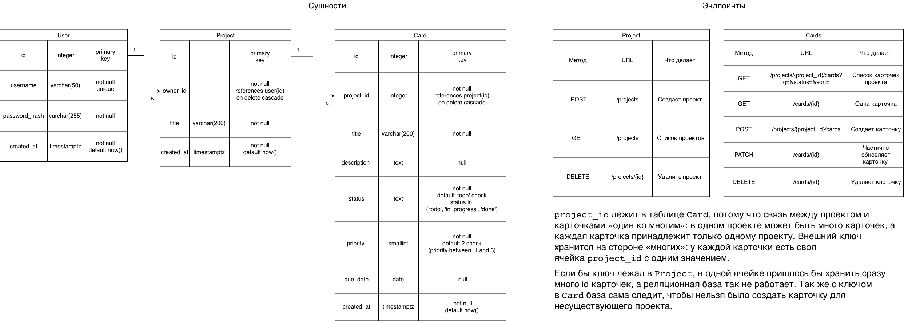

# Kanban Board

Веб-приложение «Канбан-доска». Пользователь создаёт проекты и добавляет в них карточки с задачами. Карточки делятся на три колонки: «к работе», «в процессе» и «готово».

**Учебная практика, 3 курс. Вариант 11: Канбан-доска (Проект, Карточка).**

| | |
|---|---|
| Автор | Кузмицкий Илья Константинович |
| Группа | ИСиП 1-9-24 |

## Что умеет приложение

- регистрация, вход и выход;
- каждый пользователь видит только свои проекты и карточки;
- создание и удаление проектов;
- создание, просмотр, изменение и удаление карточек;
- у карточки есть название, описание, статус, приоритет и срок.

## Технологии

| Что | Для чего |
|---|---|
| FastAPI (Python) | серверная часть |
| PostgreSQL | база данных, запускается в Docker |
| SQLAlchemy | работа с базой из Python |
| Alembic | создание таблиц (миграции) |
| HTML, CSS, JavaScript | страницы сайта |

## Как запустить

Нужны: Python, Docker и Git.

```bash
# 1. Скачать проект
git clone https://github.com/ilia228-2/Kanban-board.git
cd Kanban-board

# 2. Создать виртуальное окружение и включить его
python3 -m venv venv
source venv/bin/activate

# 3. Установить библиотеки
pip install -r requirements.txt

# 4. Запустить базу данных
docker compose up -d

# 5. Создать таблицы
alembic upgrade head

# 6. Запустить сервер
uvicorn app.main:app --reload
```

После запуска:

- сайт: http://127.0.0.1:8000/
- документация API: http://127.0.0.1:8000/docs

База данных работает на порту 5433.

## База данных

Три таблицы:

| Таблица | Поля |
|---|---|
| User | id, username, password_hash, created_at |
| Project | id, owner_id (ссылка на User), title, created_at |
| Card | id, project_id (ссылка на Project), title, description, status, priority, due_date, created_at |

Связи:

- у одного пользователя много проектов;
- в одном проекте много карточек;
- при удалении проекта его карточки удаляются вместе с ним.

Статус карточки: `todo`, `in_progress` или `done`. Приоритет: число от 1 до 3.



## Список эндпоинтов

Запросы к проектам и карточкам работают только после входа.

**Пользователь**

| Метод | URL | Что делает |
|---|---|---|
| POST | /api/auth/register | Регистрация |
| POST | /api/auth/login | Вход |
| POST | /api/auth/logout | Выход |
| GET | /api/auth/me | Текущий пользователь |

**Проекты**

| Метод | URL | Что делает |
|---|---|---|
| POST | /api/projects | Создать проект |
| GET | /api/projects | Список проектов |
| DELETE | /api/projects/{id} | Удалить проект |

**Карточки**

| Метод | URL | Что делает |
|---|---|---|
| GET | /api/projects/{project_id}/cards | Список карточек проекта |
| POST | /api/projects/{project_id}/cards | Создать карточку |
| GET | /api/cards/{id} | Одна карточка |
| PATCH | /api/cards/{id} | Изменить карточку |
| DELETE | /api/cards/{id} | Удалить карточку |

## Ответы сервера

| Код | Что значит | Когда бывает |
|---|---|---|
| 200 | Всё хорошо | получение и изменение данных, вход |
| 201 | Создано | регистрация, новый проект или карточка |
| 204 | Выполнено, ответа нет | выход, удаление |
| 401 | Нужно войти | запрос без входа или неверный пароль |
| 404 | Не найдено | записи нет или она чужая |
| 409 | Конфликт | логин уже занят |
| 422 | Неверные данные | слишком короткий пароль, неправильный статус |

**Пример: создание карточки**

Запрос:

```
POST /api/projects/1/cards
```

```json
{"title": "Сверстать главную", "priority": 3, "due_date": "2026-11-05"}
```

Ответ (код 201):

```json
{
  "id": 1,
  "project_id": 1,
  "title": "Сверстать главную",
  "description": null,
  "status": "todo",
  "priority": 3,
  "due_date": "2026-11-05",
  "created_at": "2026-10-28T03:51:05.972506Z"
}
```

Поля, которые не передали, заполняются сами: статус `todo`, приоритет 2, дата создания.

## Структура проекта

```
Kanban-board/
├── app/
│   ├── main.py          # запуск приложения
│   ├── database.py      # подключение к базе
│   ├── models.py        # таблицы
│   ├── schemas.py       # проверка данных запросов и ответов
│   ├── security.py      # хеширование паролей
│   ├── deps.py          # определение текущего пользователя
│   └── routers/         # эндпоинты: auth, projects, cards
├── migrations/          # миграции Alembic
├── static/              # страницы сайта
├── docs/                # схема базы данных
├── docker-compose.yml   # запуск PostgreSQL
├── requirements.txt     # список библиотек
└── README.md
```

## Скриншоты

<!-- Добавить после готовности сайта:


-->
